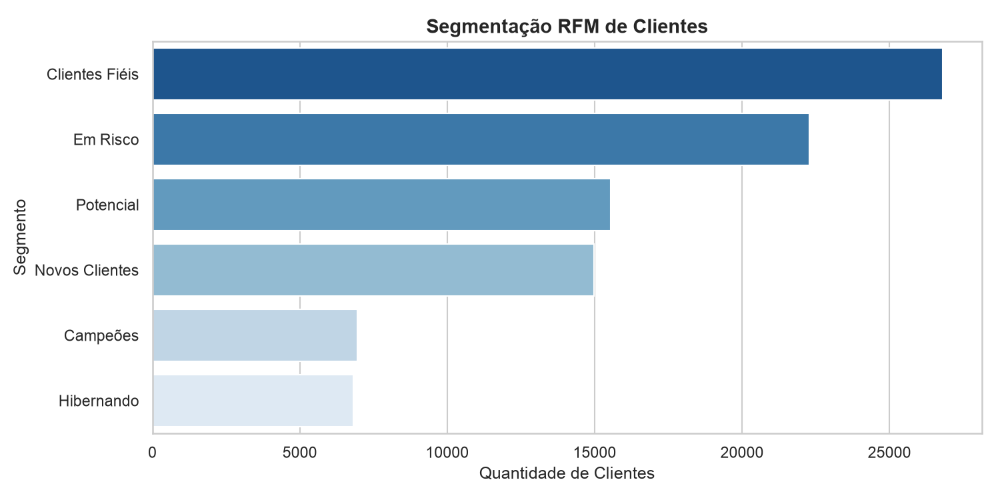
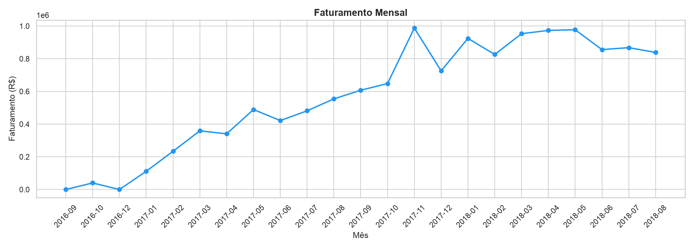
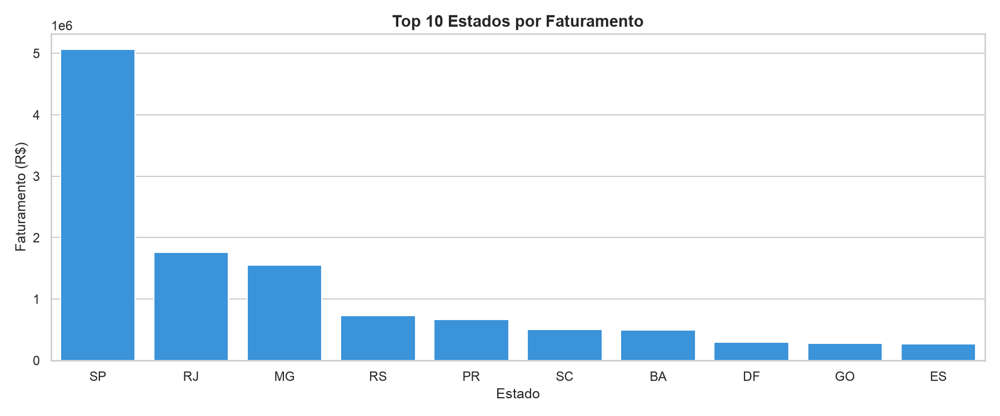
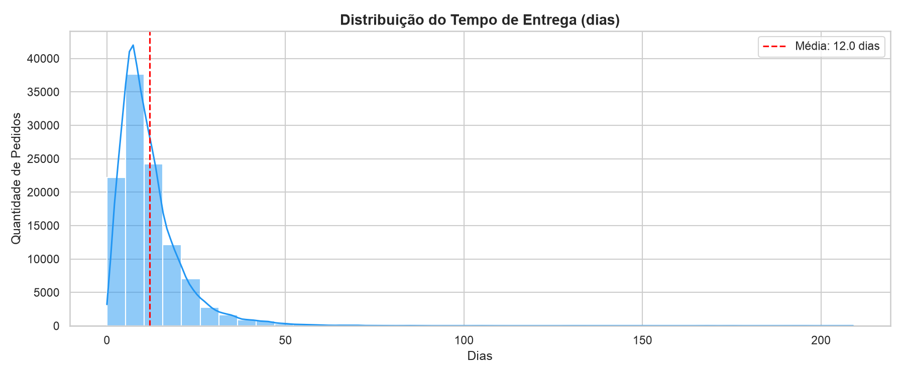
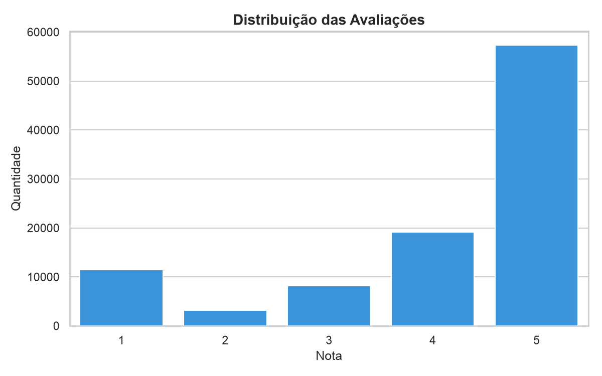

# 📊 Análise de E-commerce Olist — Comportamento de Vendas, Logística e Clientes

Projeto de análise de dados end-to-end sobre o dataset público da **Olist**, o maior marketplace de e-commerce do Brasil. O objetivo é responder perguntas de negócio reais — de onde vem o faturamento, como está a logística e quais clientes vale a pena reter — combinando **SQL**, **Python** e **Power BI**.

> Dataset: ~100 mil pedidos reais realizados entre 2016 e 2018.

---

## 🎯 Objetivo

Transformar dados brutos de vendas em **insights acionáveis** para o negócio, respondendo três perguntas centrais:

1. **Vendas** — de onde vem o faturamento (estados, categorias, vendedores)?
2. **Logística** — quanto tempo leva a entrega e onde estão os gargalos?
3. **Clientes** — quem são os clientes mais valiosos e quais estão em risco de churn?

---

## 🛠️ Ferramentas e Técnicas

| Etapa | Ferramenta | Técnicas |
|---|---|---|
| Extração e modelagem | **SQL (SQLite)** | JOINs, CTEs, `CASE WHEN`, window functions (`RANK`), agregações |
| Limpeza e análise | **Python (pandas)** | tratamento de nulos, conversão de tipos, feature engineering de datas |
| Visualização exploratória | **matplotlib / seaborn** | histogramas, gráficos de barras, análise de distribuição |
| Segmentação | **pandas** | análise **RFM** (Recência, Frequência, Valor Monetário) |
| Dashboard executivo | **Power BI** | visões de vendas, logística e clientes |

---

## 📈 Principais Insights

### 💰 Vendas
- **Faturamento total de R$ 13,2 milhões** em pedidos entregues (96.478 pedidos).
- **São Paulo concentra 38,3% de todo o faturamento** — forte dependência de um único estado.
- **Ticket médio de R$ 137,04** por pedido.
- Categorias líderes: **beleza & saúde**, **relógios & presentes** e **cama, mesa & banho**.

### 🚚 Logística
- **Tempo médio de entrega de 12 dias**, com distribuição de cauda longa (outliers chegam a +100 dias).
- Estados do **Norte (RR, AP, AM) levam até 29 dias** — quase 3x mais que o Sudeste, um risco claro para a satisfação do cliente.

### 👥 Clientes
- **93.358 clientes únicos**, mas apenas **~3% são recorrentes** — a operação depende fortemente de aquisição, não de retenção.
- **Avaliações majoritariamente positivas** (nota 5 domina), mas com forte polarização (nota 1 é a segunda mais comum).

---

## 🎯 Segmentação RFM

Os 93 mil clientes foram segmentados em 6 perfis comportamentais usando a metodologia **RFM**:

| Segmento | Clientes | Recência média | Ticket médio | Ação recomendada |
|---|---:|---:|---:|---|
| 🏆 Campeões | 6.940 | 91 dias | **R$ 280** | Programa de fidelidade, acesso antecipado |
| 💙 Clientes Fiéis | 26.799 | 145 dias | R$ 113 | Upsell e cross-sell |
| 🌱 Novos Clientes | 14.983 | 91 dias | R$ 134 | Onboarding para fidelizar |
| 📊 Potencial | 15.537 | 312 dias | R$ 170 | Nurturing e engajamento |
| ⚠️ Em Risco | 22.276 | 394 dias | R$ 149 | **Campanha de reativação** |
| 😴 Hibernando | 6.823 | 397 dias | R$ 41 | Última tentativa ou descarte |

> **Insight de negócio:** 22 mil clientes **"Em Risco"** já gastaram em média R$ 149 e sumiram há mais de um ano. Representam a **maior oportunidade de reativação** da base — recuperar uma fração deles tem custo muito menor que adquirir novos clientes.



---

## 📊 Visualizações

<table>
  <tr>
    <td></td>
    <td></td>
  </tr>
  <tr>
    <td align="center">Crescimento do faturamento (2016–2018)</td>
    <td align="center">Top 10 estados por faturamento</td>
  </tr>
  <tr>
    <td></td>
    <td></td>
  </tr>
  <tr>
    <td align="center">Distribuição do tempo de entrega</td>
    <td align="center">Distribuição das avaliações</td>
  </tr>
</table>

---

## 📁 Estrutura do Projeto

```
analiseEcommerce/
│
├── data/                    # Dataset Olist (CSVs) + banco SQLite
│   └── olist.db
│
├── sql/
│   └── queries.sql          # 9 queries analíticas comentadas
│
├── notebooks/
│   ├── 01_setup.ipynb       # Carga dos CSVs para o banco SQLite
│   ├── 02_eda.ipynb         # Limpeza e análise exploratória
│   └── 03_rfm.ipynb         # Segmentação RFM de clientes
│
├── outputs/                 # Gráficos gerados
├── powerbi/
│   └── dashboard.pbix       # Dashboard executivo (3 páginas)
│
├── requirements.txt
└── README.md
```

---

## 🚀 Como Rodar

```bash
# 1. Clone o repositório
git clone https://github.com/vitorrrfernandes/analise-ecommerce-olist.git
cd analise-ecommerce-olist

# 2. Crie o ambiente virtual e instale as dependências
python -m venv venv
source venv/bin/activate      # Windows: venv\Scripts\activate
pip install -r requirements.txt

# 3. Baixe o dataset do Kaggle e coloque os CSVs em data/
# https://www.kaggle.com/datasets/olistbr/brazilian-ecommerce

# 4. Execute os notebooks em ordem (01 → 02 → 03)
jupyter notebook
```

---

## 📚 Sobre o Dataset

Dados públicos disponibilizados pela [Olist no Kaggle](https://www.kaggle.com/datasets/olistbr/brazilian-ecommerce), cobrindo pedidos reais de 2016 a 2018. Inclui informações de pedidos, itens, produtos, vendedores, clientes, pagamentos, avaliações e geolocalização.

---

## 👤 Autor

**Vitor Fernandes**
Estudante de Sistemas de Informação (UFG) | Aspirante a Analista de Dados

[](https://linkedin.com/in/SEU-PERFIL)
[](https://github.com/vitorrrfernandes)
