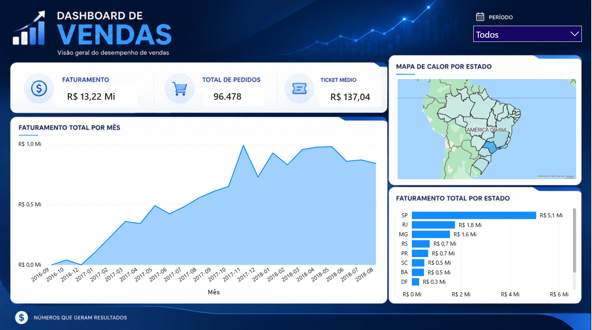
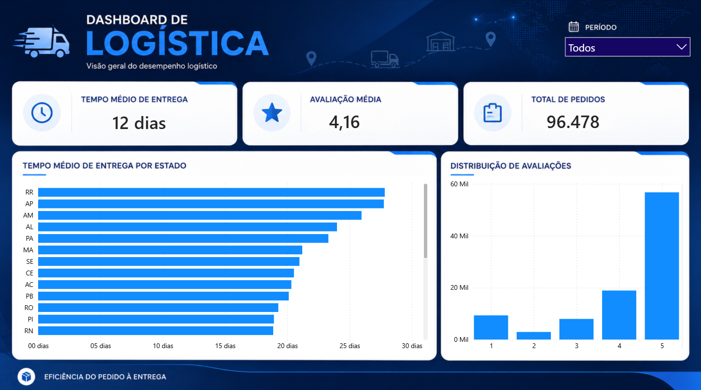
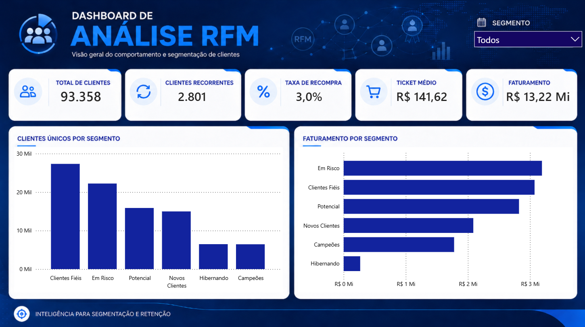

# 📊 Análise de E-commerce Olist — Comportamento de Vendas, Logística e Clientes

Projeto de análise de dados end-to-end sobre o dataset público da **Olist**, o maior marketplace de e-commerce do Brasil. O objetivo é responder perguntas de negócio reais — de onde vem o faturamento, como está a logística e quais clientes vale a pena reter — combinando **SQL**, **Python** e **Power BI**.

> Dataset: ~100 mil pedidos reais realizados entre 2016 e 2018.

---

## 🎯 Objetivo

Transformar dados brutos de vendas em **insights acionáveis** para o negócio, respondendo três perguntas centrais:

1. **Vendas** — de onde vem o faturamento (estados, categorias, vendedores)?
2. **Logística** — quanto tempo leva a entrega e onde estão os gargalos?
3. **Clientes** — quem são os clientes mais valiosos e quais estão em risco de churn?

---

## 🛠️ Ferramentas e Técnicas

| Etapa | Ferramenta | Técnicas |
|---|---|---|
| Extração e modelagem | **SQL (SQLite)** | JOINs, CTEs, `CASE WHEN`, window functions (`RANK`), agregações |
| Limpeza e análise | **Python (pandas)** | tratamento de nulos, conversão de tipos, feature engineering de datas |
| Visualização exploratória | **matplotlib / seaborn** | histogramas, gráficos de barras, análise de distribuição |
| Segmentação | **pandas** | análise **RFM** (Recência, Frequência, Valor Monetário) |
| Dashboard executivo | **Power BI** | 3 páginas: Vendas, Logística e Clientes (RFM) |

---

## 📈 Principais Insights

### 💰 Vendas
- **Faturamento total de R$ 13,2 milhões** em pedidos entregues (96.478 pedidos).
- **São Paulo concentra 38,3% de todo o faturamento** — forte dependência de um único estado.
- **Ticket médio de R$ 137,04** por pedido.
- Categorias líderes: **beleza & saúde**, **relógios & presentes** e **cama, mesa & banho**.

### 🚚 Logística
- **Tempo médio de entrega de 12 dias**, com distribuição de cauda longa (outliers chegam a +100 dias).
- Estados do **Norte (RR, AP, AM) levam até 29 dias** — quase 3x mais que o Sudeste, um risco claro para a satisfação do cliente.
- **Avaliação média de 4,16**, com forte polarização: nota 5 domina, mas nota 1 é a segunda mais frequente.

### 👥 Clientes
- **93.358 clientes únicos**, mas apenas **~3% são recorrentes** — a operação depende fortemente de aquisição, não de retenção.
- **Em Risco e Clientes Fiéis concentram quase metade do faturamento** (24% e 23% respectivamente) — mais que o dobro do peso dos Campeões (13%), mesmo estes tendo o maior ticket médio individual.

---

## 🎯 Segmentação RFM

Os 93 mil clientes foram segmentados em 6 perfis comportamentais usando a metodologia **RFM** (Recência, Frequência, Valor Monetário):

| Segmento | Clientes | Recência média | Ticket médio | Ação recomendada |
|---|---:|---:|---:|---|
| 🏆 Campeões | 6.449 | 91 dias | **R$ 275,76** | Programa de fidelidade, acesso antecipado |
| 💙 Clientes Fiéis | 27.336 | 145 dias | R$ 112,43 | Upsell e cross-sell |
| 🌱 Novos Clientes | 14.984 | 91 dias | R$ 139,31 | Onboarding para fidelizar |
| 📊 Potencial | 15.881 | 312 dias | R$ 177,77 | Nurturing e engajamento |
| ⚠️ Em Risco | 22.230 | 394 dias | R$ 143,61 | **Campanha de reativação** |
| 😴 Hibernando | 6.478 | 397 dias | R$ 41,15 | Última tentativa ou descarte |

> **Insight de negócio:** os clientes **"Em Risco"** e **"Clientes Fiéis"** juntos respondem por quase metade do faturamento total, mesmo sem o maior ticket médio individual — o volume da base compensa o valor por cliente. Isso indica que reter esses dois grupos tem retorno potencialmente maior do que investir apenas em programas de elite para os "Campeões". Recuperar uma fração dos 22 mil clientes "Em Risco" custa muito menos do que adquirir novos clientes.

---

## 📊 Dashboard Power BI

Dashboard executivo com 3 páginas, identidade visual consistente e cores escolhidas para reforçar o significado de cada segmento (dourado para Campeões, laranja de alerta para Em Risco, cinza neutro para Hibernando).

### Página 1 — Visão geral de vendas
Faturamento, ticket médio, evolução mensal e ranking de estados.



### Página 2 — Logística
Tempo médio de entrega por estado e distribuição das avaliações dos clientes.



### Página 3 — Clientes (RFM)
Segmentação RFM, ticket médio por segmento e participação de cada segmento no faturamento total.



O arquivo completo e interativo está em [`powerbi/dashboard_ecommerce_olist.pbix`](powerbi/dashboard_ecommerce_olist.pbix).

---

## 📊 Visualizações exploratórias (Python)

<table>
  <tr>
    <td></td>
    <td></td>
  </tr>
  <tr>
    <td align="center">Crescimento do faturamento (2016–2018)</td>
    <td align="center">Top 10 estados por faturamento</td>
  </tr>
  <tr>
    <td></td>
    <td></td>
  </tr>
  <tr>
    <td align="center">Distribuição do tempo de entrega</td>
    <td align="center">Distribuição das avaliações</td>
  </tr>
  <tr>
    <td colspan="2" align="center"></td>
  </tr>
  <tr>
    <td colspan="2" align="center">Segmentação RFM de clientes</td>
  </tr>
</table>

---

## 📁 Estrutura do Projeto

```
analiseEcommerce/
│
├── data/                              # Dataset Olist (CSVs) + banco SQLite
│   └── olist.db
│
├── sql/
│   └── queries.sql                    # 9 queries analíticas comentadas
│
├── notebooks/
│   ├── 01_setup.ipynb                 # Carga dos CSVs para o banco SQLite
│   ├── 02_eda.ipynb                   # Limpeza e análise exploratória
│   └── 03_rfm.ipynb                   # Segmentação RFM de clientes
│
├── outputs/                           # Gráficos gerados em Python
│
├── powerbi/
│   ├── dashboard_ecommerce_olist.pbix # Dashboard executivo (3 páginas)
│   ├── dados/                         # CSVs de apoio para o Power BI
│   └── prints/                        # Screenshots das 3 páginas
│
├── requirements.txt
└── README.md
```

---

## 🚀 Como Rodar

```bash
# 1. Clone o repositório
git clone https://github.com/vitorrrfernandes/analise-ecommerce-olist.git
cd analise-ecommerce-olist

# 2. Crie o ambiente virtual e instale as dependências
python -m venv venv
source venv/bin/activate      # Windows: venv\Scripts\activate
pip install -r requirements.txt

# 3. Baixe o dataset do Kaggle e coloque os CSVs em data/
# https://www.kaggle.com/datasets/olistbr/brazilian-ecommerce

# 4. Execute os notebooks em ordem (01 → 02 → 03)
jupyter notebook

# 5. Abra powerbi/dashboard_ecommerce_olist.pbix no Power BI Desktop
```

---

## 📚 Sobre o Dataset

Dados públicos disponibilizados pela [Olist no Kaggle](https://www.kaggle.com/datasets/olistbr/brazilian-ecommerce), cobrindo pedidos reais de 2016 a 2018. Inclui informações de pedidos, itens, produtos, vendedores, clientes, pagamentos, avaliações e geolocalização.

---

## 👤 Autor

**Vitor Fernandes**
Estudante de Sistemas de Informação (UFG) | Aspirante a Analista de Dados

[](https://linkedin.com/in/SEU-PERFIL)
[](https://github.com/vitorrrfernandes)